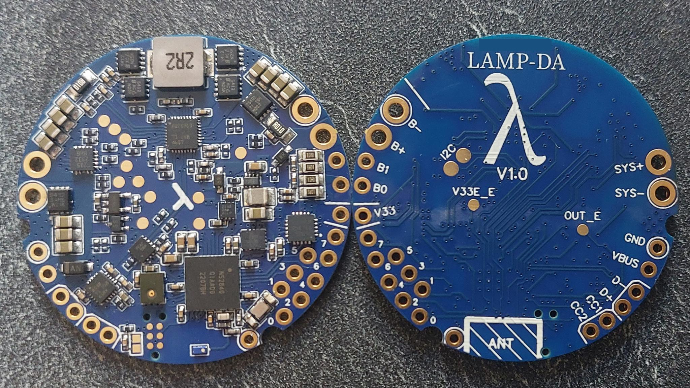
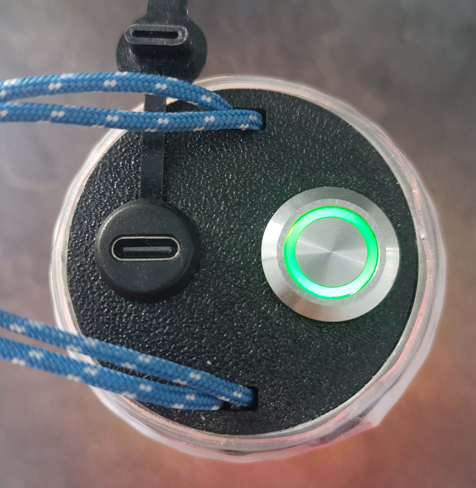
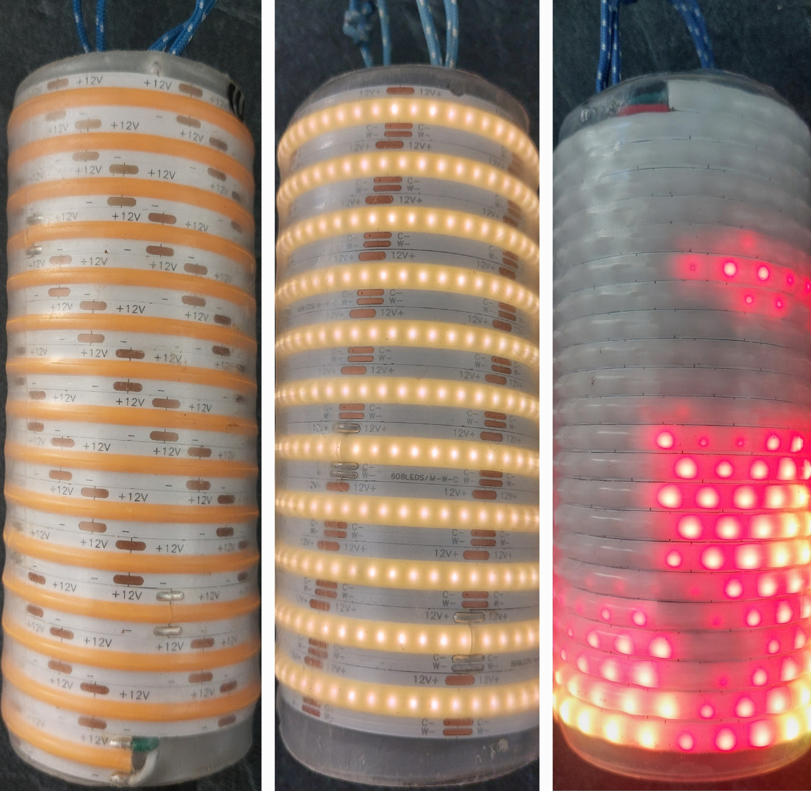

# Lamp-Da

  

A programmable board integrated with a liion battery charger, battery balancer, multiple sensors and gpios (with 3 analog inputs).

This repository contains the bootloader, software and hardware files to create and program the board.

The system supports programming and charge throught the same USB-C port.

The board is made to fit into a 50mm tube.

## File details
- LampColorControler.ino: main class of the program, containing the setup and loop functions

## Physical build and architecture :

The electrical circuit and build files can be found in the **physical/electrical** folder.

The PCB can be ordered directly assembled from JLC PCB, for a total cost of around 270$ for the minimal 5 pieces command (price drops with a more commands, until around 22$/circuit).

The circuit is 3 cells li-ion USB C charger & balancer & power source, that is also programmable via the same USB port.

The circuit features:
- USB-C 3S li-ion charger, based on BQ25713 ic.
- Battery balancing, based on BQ76905 ic.
- USB short circuit and EC protection, based on TPD8S300 ic.
- USB-C power negotiation, base on FUSB302B ic.
- Programable voltage source, from 3V to 20V, up to 3A, using the charge component
- 8 programmable IO pins (3 of which can be analog inputs, 4 can be pwm outputs). Based on nRF52840 ic.
- MEMS Microphone, placed away from parasitic ringing components.
- LSM6DS3TR IMU
- Bluetooth 5.1 low power, with 5/10m range.

- Multiple protection features (ESD spikes protection, USB voltage snubber, USB voltage limitation, ...)

Be careful:
- **NO REVERSE VOLTAGE PROTECTION FOR BATTERY**: it will blow the circuit right up
- **IO are 3.3V max**, any voltage greater will destroy the system

## Update the system

You can update the program without any tools :

Open a serial connection to the lamp, and use the "DFU" command to reset the system.
The system will appear on a computer as a USB file device.

You just need to copy the .uf2 file matching your lamp type into this USB device.
It will then reboot and update the system itself.

## Behavior

The code in this repo is made to be used as compact lanterns.

base behavior:
- The lamp starts and stops with one click.
- The luminosity can be raised by clicking than holding, and diminished by double-clicking than holding.

Some behaviors can be moved to other clicks with the command line (over USB serial, or Bluetooth UART):

| Behavior | Name | Default clicks | Click action | Hold action |
|----------|------|----------------|--------------|-------------|
| Custom ramp | `ramp` | 3 | | configure the custom ramp of the mode |
| Favorites | `favorite` | 4 | jump to the favorites | add or remove a favorite |
| Sunset timer | `sunset` | 5 | | start or extend the sunset timer |
| Quick navigation | `nav` | 6 | jump to the first mode | |
| Scroll | `scroll` | 6 | | scroll across modes and groups |
| Indicator brightness | `indicator` | 7 | next brightness | cycle the brightness |

- `sys bind` shows the current links, `set bind nav 8` moves a behavior and `set bind_reset` restores the defaults.
- The click and hold actions of a behavior always move together, to 4 up to 9 clicks (3 up to 9 for `ramp`, `scroll` and `sunset`, that have no click action).
- A click only and a hold only behavior can share the same clicks, like `nav` and `scroll`. Otherwise, the behaviors already on these clicks swap with the moved one. A swap that would leave two behaviors on the same action is refused: move the other behavior first.
- 1 and 2 clicks (on/off, next mode, brightness), 3 clicks (next group, or quit the favorites) and 10 clicks and above (shutdown, resets) cannot be changed.
- Links are saved when the lamp shuts down, and clearing the user parameters restores the defaults.
- Commands of the lamp when it is off keep priority whatever the links: 3 clicks + hold starts in button usermode (so `sunset` on 3 clicks only works when the lamp is on) and 4 clicks toggles the lockout. In button usermode, a 5 clicks hold still exits after 5 seconds.
- CCT lamps can only move `indicator`, to 5 up to 9 clicks: 3 and 4 clicks + hold are their color ramps.

The battery level is displayed as a color gradient from green (high) to red (low).

When the lamp is on, the output blinks once when the battery goes under 75%, twice under 50% and three times under 25%. A level passed during the first 10 seconds of use is never displayed, even after this delay. Each level is displayed once until the lamp is turned off and on again. Use `set bat_blink 0` to disable the blinks, `set bat_blink 1` to enable them, and `sys bat_blink` to check the current choice. This choice is saved when the lamp shuts down.

Error and alerts are displayed as blinking animations:
- low battery: slow red blinks
- critical battery: fast red blinks, emergency shutdown after short delay
- charging: breeze animation, changing color to indicate battery level
- incoherent battery readings: fast green/red blinks (battery reading do not match the set battery type)
- main loop too slow: fast fushia blinks
- temperature too high: fast orange blinks
- temperature extreme: emergency shutdown
- OTG failed: pink/yellow fast blink (failed to start the output power)
- bluetooth advertising: blue breeze animation
- hardware alert: fast purple/cyan blinks: generic alert to indicate the failure of a component, without recovery
- system off failed : fast purple/white blinks : system failed ot go to sleep, it will reset to default program and will need to be reflashed
- system in error state : fast pink/orange, then shutdown : reached an error state and is stuck here. Shutdown after five seconds
- unhandled: fast white blinks

### User defined behaviors
The user MUST define the target behavior for the target uses.

Some functions are defined in functions.h files, and must be implemented in functions.cpp
They allow the user to program the exact desired behavior.

Some user types are available for base models, in the user folder:
- cct: Program designed for a constant color temperature led strip.
- indexable: program designed for an indexable led strip wrapped around the lamp body
- simple: Program designed for a constant color led strip

Above: simple, cct, indexable

#### Bootloader flash
Out of factory, the board will miss a bootloader.

- Use a raspberry of any other linux system with gpios
- Use the open source program **openocd** as described in the **flashInfo** folder of this repository.

# Building the project

## Quick Setup

The supported platform to work with the project is:

 - Linux (Debian/Ubuntu/Archlinux/etc)

You will find a full guide on how to build the project here:

 - [Quick Setup](docs/QuickSetup.md) -- also lists all required dependencies

Note that after building documentation, it will be in `docs/html/index.html`

## Other Guides

You will find a guide on how to update the system via USB

 - [Update DFU](docs/Update.md)

You will find a guide on how to setup a virtual machine to build the project:

 - [Virtual Machine](docs/VirtualMachine.md) -- experimental, work-in-progress

You will find contribution guidelines to the project here:

 - [Contributing](docs/Contributing.md) -- **required to read for contributors**

As a beginner, you will find a guide to develop your own lighting mode here:

 - [Writing Modes](docs/WritingModes.md)

And a big thanks to all the people that helped !

 - [Thanks](docs/Thanks.md)

--------------------------------------------

Feel free to open an issue to ask your questions or give your ideas!
